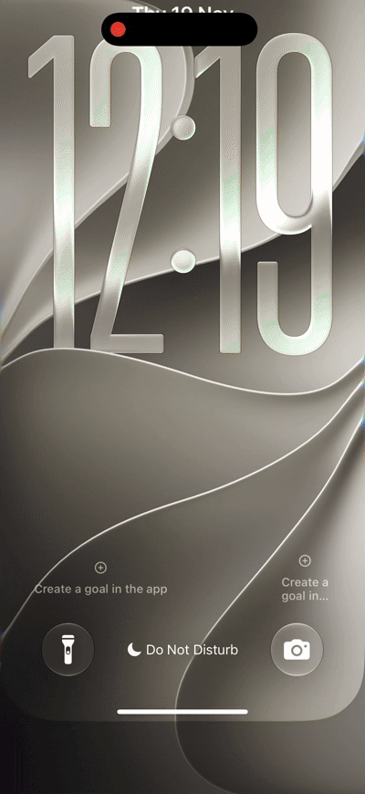
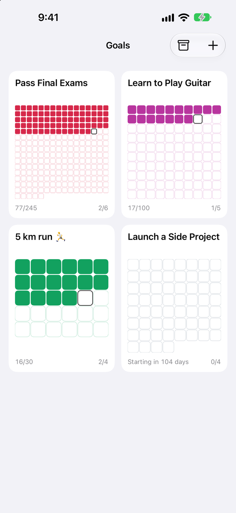
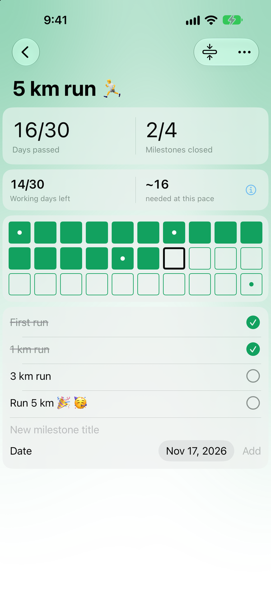
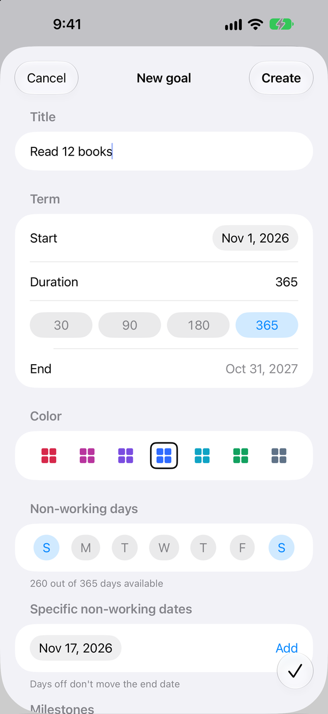
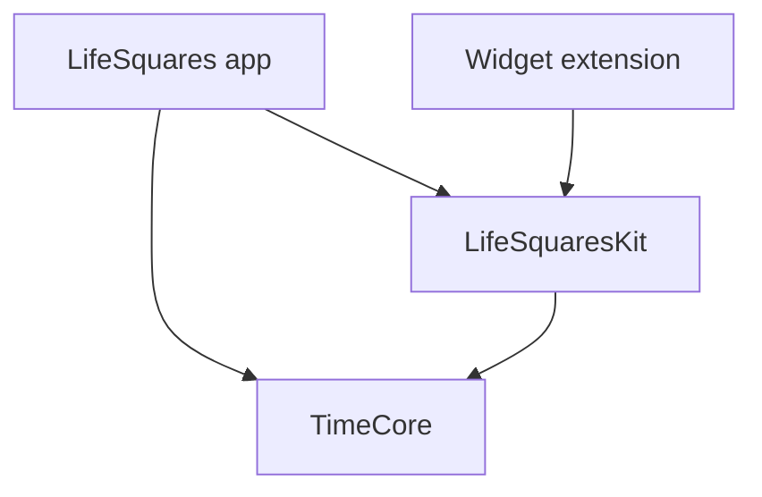

# LifeSquares

**See your goal as a grid of days.** LifeSquares turns a goal with a deadline into a grid where every square is one day — so you always see how much time has passed, how much is left, and whether you're on pace.

<p align="center">
  
</p>

<p align="center">
  <a href="APP_STORE_LINK"></a>
</p>

<p align="center">
  
  
  
  
</p>

## Screenshots

| Goals | Goal detail | New goal | Archive | Widgets |
|:---:|:---:|:---:|:---:|:---:|
|  |  |  |  |  |

## Features

- **Day grid** — every day between start and deadline is a square: past, today, future.
- **Days off** — exclude weekdays (e.g. weekends) and specific dates; progress and forecast count only working days.
- **Milestones** — break a goal into steps and close them as you go.
- **Forecast** — estimates how many working days you need at your current pace. It stays hidden until there's enough data (at least one closed milestone and 20% of working days elapsed), so it doesn't guess from noise.
- **Archive** — finished goals move out of the main list automatically.
- **Widgets** — Home Screen (small, medium) and Lock Screen (circular, rectangular, inline), with a configurable goal per widget.
- **Localized** in English, Polish and Russian, including proper plural forms.
- **Accessibility** — VoiceOver labels for grid and stats.

## Architecture

The project is split into two local Swift packages and two targets that consume them:



| Module | Responsibility | Depends on |
|---|---|---|
| **TimeCore** | Pure date logic: goal timeline, working-day availability, milestone progress, forecast. Value types only, `Sendable`, no UI and no persistence. | Foundation |
| **LifeSquaresKit** | Shared layer for the app and the widget: SwiftData models (`Goal`, `Milestone`), the shared `ModelContainer` in an App Group, and the grid UI components. | TimeCore, SwiftData, SwiftUI |
| **LifeSquares** (app) | Feature screens (list, detail, add/edit, archive), MVVM view models, navigation. | LifeSquaresKit, TimeCore |
| **Widget** | Timeline provider, App Intent for goal selection, widget views. | LifeSquaresKit |

**Why this split:**

- **TimeCore has no dependencies on UI or storage**, so the trickiest part of the app — date math — is tested in isolation and runs on macOS with plain `swift test`, without a simulator.
- **The widget and the app share one source of truth.** Models, the data container and the grid view live in `LifeSquaresKit`, so the widget can't drift from the app.
- **Dates are normalized to the start of day through an injected `Calendar`**, never through raw `TimeInterval` arithmetic. That keeps day counting correct across time zones and DST transitions.

## Testing

135 tests written with **Swift Testing**:

- **TimeCore** (~96% coverage) — timeline, availability, forecast, milestone progress, days off.
- **LifeSquaresKit** — SwiftData models and relationships on an in-memory container, grid layout, snapshot text.
- **App** — view models for goal creation and goal detail.

Date tests use a fixed `Calendar` with an explicit time zone, including DST edge cases.

CI runs the whole test plan on every push and pull request via GitHub Actions.

## Tech stack

SwiftUI · SwiftData · WidgetKit · App Intents · Swift Testing · Swift Package Manager · String Catalogs · GitHub Actions / Xcode Cloud

## Getting started

**Requirements:** Xcode XCODE_VERSION, iOS 18+.

```bash
git clone https://github.com/GITHUB_USERNAME/LifeSquares.git
cd LifeSquares
open LifeSquares.xcodeproj
```

To run on a device, select your own development team and replace the App Group `group.com.yaroslavgoncharov.LifeSquares` with yours — in both targets' entitlements and in `SharedModelContainer.appGroupId`.

**Run tests:**

```bash
# Date logic only, no simulator needed
cd TimeCore && swift test

# Full test plan
xcodebuild test \
  -project LifeSquares.xcodeproj \
  -scheme LifeSquares \
  -testPlan LifeSquaresTestPlan \
  -destination 'platform=iOS Simulator,name=iPhone 17 Pro'
```

## License

The source code is licensed under the [MIT License](LICENSE).

The LifeSquares name, app icon, and App Store materials are not covered by this license and may not be used to publish a copy of the app.

---

Designed and built by **Yaroslav Honcharov** · [LinkedIn](LINKEDIN_URL)
